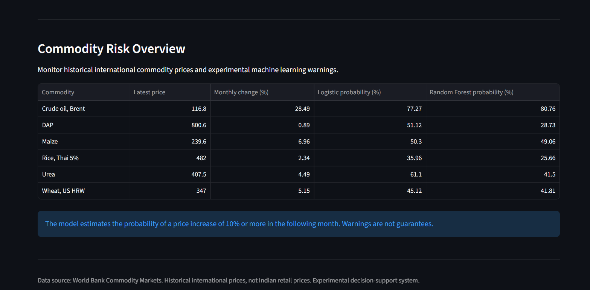
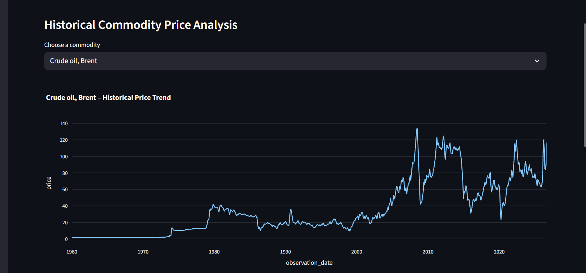
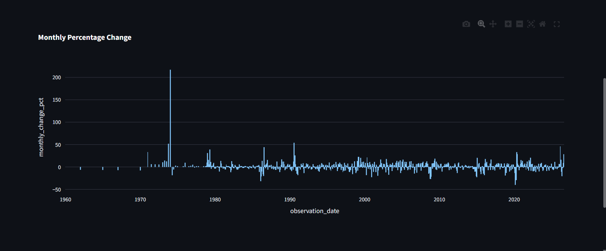
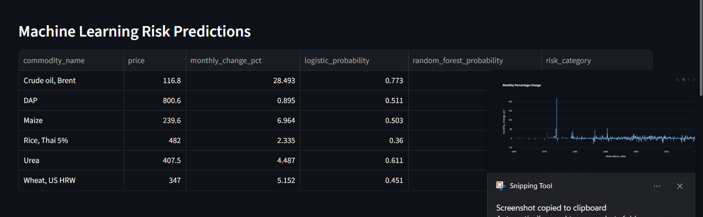
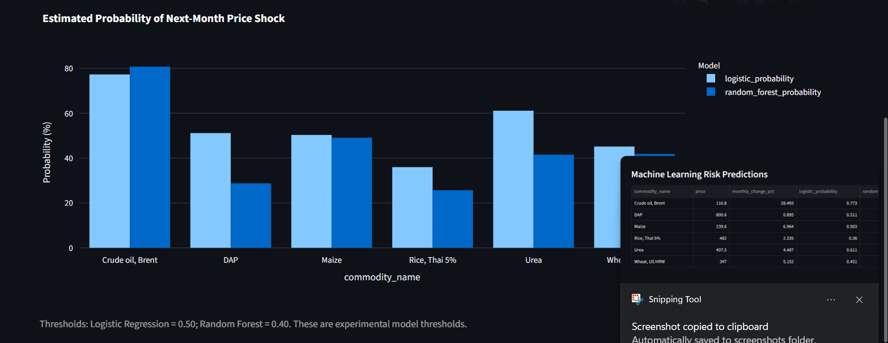
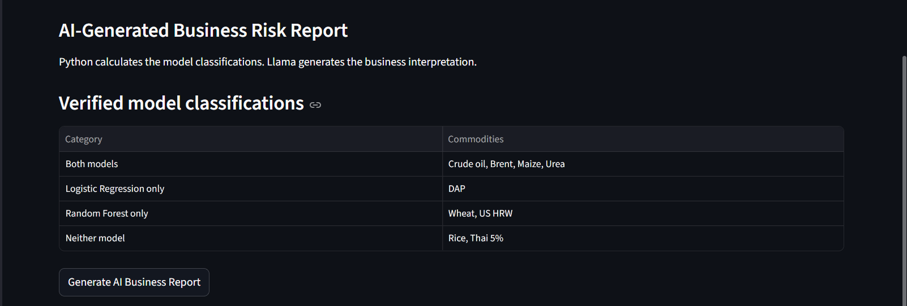
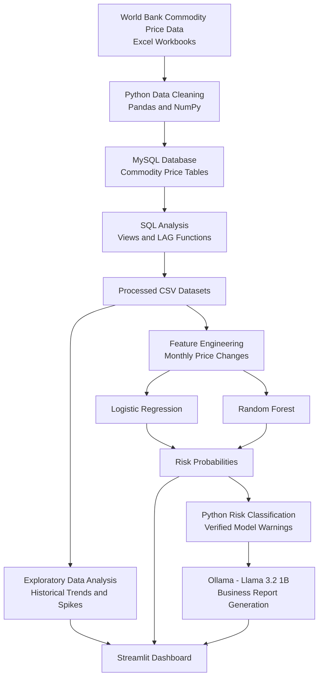

# 🌍 4F ShockRadar AI
### AI-Powered Commodity Price Risk Monitoring and Early Warning System

## Project Overview

4F ShockRadar AI is an end-to-end data analytics and machine learning project designed to monitor international commodity price movements and identify potential price shocks.

The project explores four interconnected areas:

- **Food:** Maize, rice and wheat
- **Fuel:** Brent crude oil
- **Fertiliser:** DAP and Urea
- **Finance:** Future integration of exchange rates and financial indicators

It combines data engineering, SQL, exploratory data analysis, machine learning, local Generative AI and interactive visualisation.

## Business Problem

Sudden commodity price increases can create challenges for businesses involved in procurement, supply chains and cost management.

This project explores whether historical commodity price patterns can help identify potential price increases early enough to support closer monitoring and business planning.

## Project Objectives

- Analyse historical international commodity prices.
- Identify historical price movements and unusual increases.
- Build machine learning models to estimate next-month price shock risk.
- Generate business-oriented insights using a locally running LLM.
- Develop an interactive dashboard for monitoring commodity trends and predictions.

## Technologies Used

| Area | Tools |
|---|---|
| Programming | Python |
| Data processing | Pandas, NumPy |
| Database | MySQL |
| Data analysis | SQL, Exploratory Data Analysis |
| Machine learning | Scikit-learn |
| Visualisation | Plotly |
| Dashboard | Streamlit |
| Generative AI | Ollama, Llama 3.2 1B |
| Model storage | Joblib |
| Development | Jupyter Notebook |

## Dataset

Source: World Bank Commodity Markets – Pink Sheet historical commodity prices.

Six commodities analysed:

1. Crude oil, Brent
2. DAP
3. Maize
4. Rice, Thai 5%
5. Urea
6. Wheat, US HRW

The processed dataset contains 4,722 monthly observations across six commodities, covering January 1960 to September 2026.

These are international commodity price series, not Indian retail prices.

## Machine Learning

Two classification models were developed:

- Logistic Regression
- Random Forest

**Prediction target:** Whether a commodity's price will increase by at least 10% in the following month.

A chronological train/test split was used to respect the time dimension.

### Model evaluation

| Metric | Logistic Regression | Random Forest |
|---|---:|---:|
| Accuracy | 63.33% | 78.02% |
| Precision | 11.17% | 15.05% |
| Recall | 61.19% | 46.27% |
| F1-score | 18.89% | 22.71% |
| PR-AUC | 0.2173 | 0.1388 |

The models have relatively low precision, meaning many warnings do not correspond to actual high-increase observations. Logistic Regression provides higher recall and PR-AUC in this evaluation, while Random Forest provides higher accuracy and F1-score.

These results are exploratory, not evidence of a production-ready forecasting system. Model comparisons and threshold selection used the evaluation data, so independent future validation is still required.

## GenAI Integration

A local Llama 3.2 1B model is used through Ollama to generate business-oriented commodity risk reports.

Python performs the model classification and supplies verified results to the LLM for interpretation.

No OpenAI API key is required.

## Interactive Dashboard

The Streamlit dashboard provides an interactive interface for monitoring commodity price movements and machine learning risk predictions.

### 1. Overview


### 2. Price Trends



### 3. ML Risk Predictions



### 4. AI Business Report


## Project Structure

## System Architecture

The following diagram illustrates the end-to-end workflow of 4F ShockRadar AI.



```text
4F Shock radar/
│
├── dashboard/
│   └── app.py
│
├── data/
│   ├── raw/
│   └── processed/
│       ├── commodity_prices_clean.csv
│       ├── commodity_prices_long.csv
│       └── commodity_monthly_changes.csv
│
├── models/
│   ├── logistic_shock_model.pkl
│   ├── random_forest_shock_model.pkl
│   └── model_thresholds.pkl
│
├── notebooks/
│   ├── 01_data_exploration.ipynb
│   └── 02_genai_shockradar.ipynb
│
├── sql/
│
├── README.md
├── requirements.txt
└── .gitignore
```

## Installation and Setup

### 1. Clone the repository

```bash
git clone YOUR_GITHUB_REPOSITORY_URL
cd "4F Shock radar"
```

### 2. Install dependencies

```bash
python -m pip install -r requirements.txt
```

### 3. Install and run Ollama

Install Ollama from https://ollama.com/

Download the local model:

```bash
ollama pull llama3.2:1b
```

### 4. Launch the dashboard

```bash
python -m streamlit run dashboard/app.py
```

The dashboard will open in your browser.

## Limitations and Future Improvements

- Integrate exchange-rate and financial pressure indicators to strengthen the Finance dimension.
- Add Indian domestic food price data to explore local market relevance.
- Improve model precision and evaluate performance through rolling-origin validation.
- Add weather, geopolitical and supply-chain indicators.
- Develop automated data updates.
- Evaluate predictions against genuinely unseen future observations.

## Conclusion

4F ShockRadar AI demonstrates an end-to-end approach to analysing commodity price movements and exploring machine learning-based early warning signals.

It combines analytical techniques with an interactive dashboard and locally hosted Generative AI to translate technical findings into business-oriented insights.

The system is an experimental decision-support prototype, not a validated crisis forecasting system.
